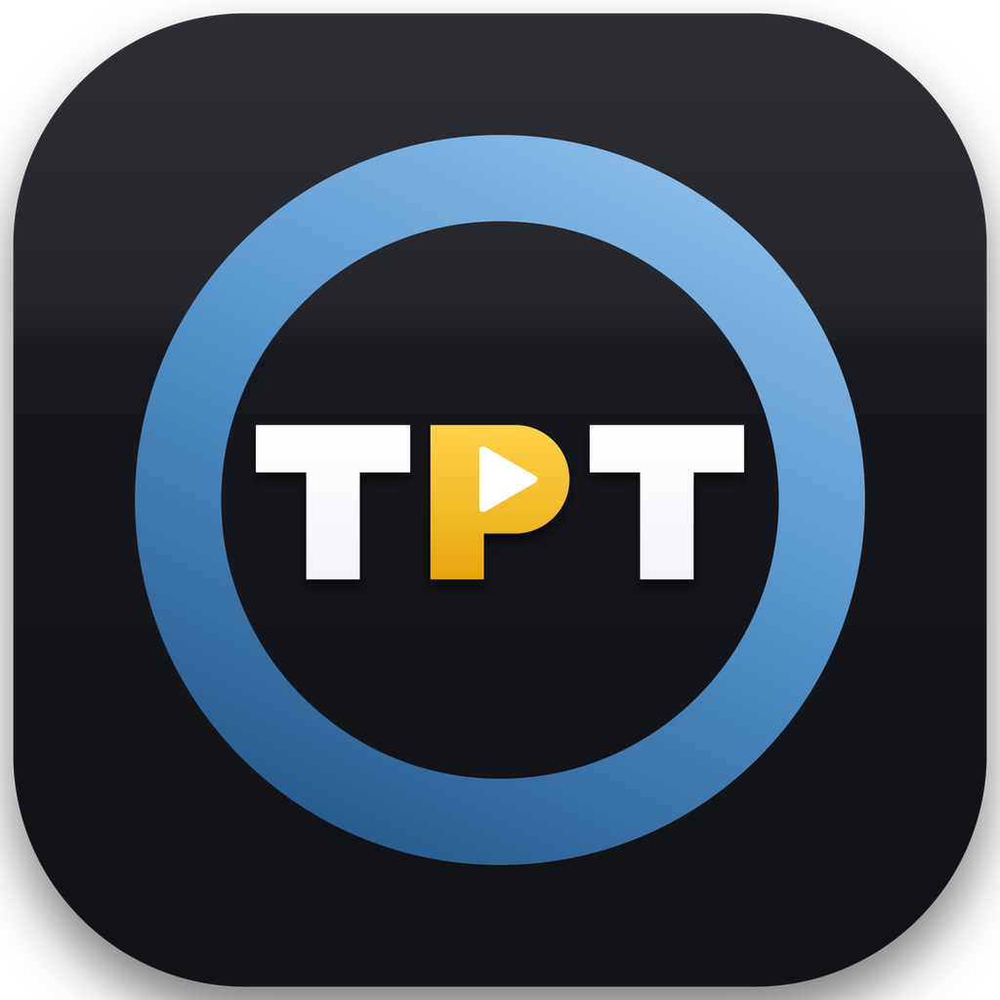

# Torrent Para Todos

**Nunca Menos.**

Aplicación de escritorio para bajar, organizar y ver películas, series y videos por categorías, con una app para el celular que la maneja desde el sillón.

## Descargar

**[⬇ TorrentParaTodos-Setup-1.14.2.exe](https://github.com/facuperma/TorrentParaTodos/raw/main/instalador/TorrentParaTodos-Setup-1.14.2.exe)** (94 MB): para la PC (Windows 10/11, 64 bits). No pide Python ni permisos de administrador. Como no está firmado, Windows puede decir «Windows protegió su PC»: **Más información → Ejecutar de todas formas**.

**[⬇ TorrentParaTodos-Android-1.2.12.apk](https://github.com/facuperma/TorrentParaTodos/raw/main/instalador/TorrentParaTodos-Android-1.2.12.apk)** (4 MB): app para el celular (Android 8 o más nuevo).

También desde la **[página de Torrent Para Todos](https://facuperma.github.io/TorrentParaTodos/#bajar)** (en la compu muestra un QR para bajar la app).

**¿Es el original?** El botón **🔒 Bajar verificado** de esa página compara la huella SHA-256 con la de [`instalador/SHA256.txt`](instalador/SHA256.txt). A mano: `Get-FileHash TorrentParaTodos-Setup-1.14.2.exe` en PowerShell.

La biblioteca y la configuración se guardan en `%LOCALAPPDATA%\TVon`.

## Lo principal

- **Biblioteca:** agregá archivos o carpetas (o arrastralos). No se copian ni se mueven, solo se guarda la ruta. Los videos de *Videos* y *Documentos* y los que terminan de bajarse en *Descargas* entran solos, con su título limpio, subtítulos y categoría (`Videos\Peliculas\<título>`). Lo que quitás no vuelve solo.
- **Categorías y Favoritos:** clic derecho para asignar, quitar o crear; **⚡ Categoría rápida** con el título del video; **★ Favoritos** siempre primera. Las categorías con algo por ver van en amarillo y las completas en verde.
- **Vistos y dónde quedaste:** recuerda el punto de cada video (visto al pasar el 90 %), la **cola de reproducción** (☰), el **siguiente capítulo automático** y **⏭ Saltar intro** en las series.
- **Fichas:** póster, sinopsis, géneros y puntaje de cada película y serie (Wikipedia y TVmaze sin configurar nada; con una clave gratis de TMDb sale mejor y en español).
- **🧲 Torrents:** pegá un magnet o abrí un `.torrent`; baja con [aria2](https://aria2.github.io) (incluido), solo la película (sin extras), sin programas ni ejecutables, y sigue en segundo plano junto al reloj.
- **🎞 Dominio público:** unas 25.000 películas del Internet Archive, con descarga automática opcional.
- **🎬 Letterboxd y búsqueda:** tu watchlist pública y las 500 mejor puntuadas, marcando las que ya tenés; el buscador de arriba filtra la biblioteca y, con Enter, busca cualquier película o serie para bajar (entiende «temporada 2», `S03E07`, «completa»…).
- **🎬 Modo simple** (en la barra de menús): una grilla con los pósters de tus películas y series, como en la app del celular; al elegir una, en el lugar del reproductor aparece su ficha (año, géneros, puntaje, de qué trata y los capítulos) con **▶ Reproducir**. Se recuerda al volver a abrir.
- **Idioma de los subtítulos:** se elige al instalar entre todos los idiomas y sus variantes por país (cientos) y se cambia en *Configuración → Preferencias*. En español, cada película que termina de bajarse busca sola su subtítulo en [subtis.io](https://subtis.io) (por el archivo exacto, por el nombre o por título y año); si no hay, no pasa nada.
- **Subtítulos:** `.srt`/`.vtt` junto al video se cargan solos; búsqueda en OpenSubtitles (clave gratis) y subdivx; los que bajás por tu cuenta (`.srt`, `.zip`, `.rar`, `.7z`, packs de temporada) se ubican solos junto a su video. Sincronía fina (◀◀ ◀ ▶ ▶▶, 🎯 Ahora; teclas G / H) que se recuerda por video.
- **📺 Chromecast y Roku:** el botón 📺 manda el video a la tele (MKV, HEVC o DTS los convierte ffmpeg: botón *Instalar ffmpeg*). El canal de **Roku** muestra la biblioteca con un reproductor estilo Netflix: `roku/LEEME.md`.
- **🛠 Modo desarrollador** (*Vista* o **Ctrl+2, 3**): cambiás colores, letra, tamaño y aire de toda la interfaz; ordenás, renombrás y escondés los botones de la barra y los controles del reproductor; mostrás u ocultás secciones y cambiás el orden de las columnas. Todo se ve al instante y se guarda en presets.
- **Varios videos:** *Abrir en ventana* (📌 siempre encima), **⏻ Apagar** al terminar, **🗑 Eliminar del disco** (a la Papelera) y **🖥 Modo Fullscreen** (F11).
- **🎨 Tema «Moderno» y 23 temas retro** (*Vista → Apariencia*): el Moderno es el de siempre ahora (cada zona con su gris, botones con forma y sombreado, categorías como tarjetas, filas separadas, letra Inter); los retro cambian colores, letra, forma de botones y una banda animada arriba (Galaxia P2P, Lámpara de llama, Luna, Gel azul, Fósforo, Neón Y2K, Casete 85, Arcade 8 bits, Videoclub…). También en el celular.

## 🎬 Tu BiriBiri, cuenta y amigos

Arriba a la derecha está **tu BiriBiri**: un muñequito 3D (Qt Quick 3D) que armás a tu gusto, con **tu foto en la cara** dentro de una escotilla redonda.

- **Aspecto:** género (hombre, mujer, no binario), 9 ojos, 10 cejas, 9 bocas (las abiertas son un hueco real con lengua y dientes), 13 prendas, 8 lentes con color de borde, peinados (el afro, redondo y suave), 10 estilos de barba y bigote, sombrero de paja, kipá y la **bandera de tu país flameando de fondo**, que se puede mover, agrandar e inclinar.
- **Poses:** normal, en T, celebrando, brazos cruzados, manos en la cintura, corriendo, acostado haciéndose el lindo, sentado con las piernas cruzadas, haciendo la vertical, saludando, volando, nadando, bailando, patada de karate y dormido. Se gira arrastrándolo, en cualquier dirección; con la rueda del mouse se le hace zoom y con el clic derecho se mueve la vista (doble clic: vuelve todo).
- **Otros lugares:** además de apoyado en el logo, puede **nadar detrás del logo**, estar **sentado debajo de la lista**, **acostado arriba del buscador**, **saludando en la esquina del reproductor** o **parado sobre la barra de abajo** (pestaña *🧍 Pose y lugar*).
- **Mascota:** un perro (labrador, salchicha, pug, husky, dálmata, caniche) o un gato (atigrado, siamés, negro, naranja, persa, manchado), con el color que quieras, parado a su lado. Juntos pueden hacerse mimos, darse un premio (hueso o pescadito), llenar el plato o jugar a la pelota (pestaña *🐾 Mascota*).
- **Mi videoteca:** la ventana del BiriBiri es una habitación ancha donde viven él y su mascota. Cambiás el piso y las paredes (madera, baldosas, mármol, ladrillo, rayas, colores…), comprás muebles (sillón, silla gamer, tele, cama, heladera, biblioteca, lámpara, planta, alfombra, mesa) y adornos para la pared (ventana con cortinas, cuadros, póster, reloj, espejo, guirnalda de luces), y los acomodás arrastrándolos sobre una cuadrícula de medias celdas, girándolos de a 45°; la bandera también se cuelga donde quieras. Antes de comprar ves cómo es. BiriBiri y la mascota tienen **vida propia**: pasean, se sientan solos, la mascota se sube a la falda y se hacen mimos. También se sientan en el sillón o en la silla gamer (solo, con la mascota en la falda o los dos juntos). Las **monedas** se ganan viendo películas (50) y capítulos (10), una sola vez cada uno. Con una cuenta, tus **amigos visitan tu videoteca** (y vos la de ellos). Se maneja como un juego: la habitación ocupa toda la ventana y una botonera abre los paneles (Personaje, Decorar, Tienda, Amigos, Cuenta). Un clic elige a un personaje y otro lo manda a un lugar; doble clic abre su menú de acciones.
- **🎮 Esquivá:** un juego de habilidad dentro de Mi videoteca. Con las flechas llevás la cabeza de BiriBiri, juntás las entradas de cine y llegás a la salida sin que te toque ningún rollo de película (van y vienen, dan vueltas, giran en aspas). Hay zonas verdes de control, contador de muertes y más de 60 niveles, cada uno comprobado para que se pueda pasar. Cada nivel superado por primera vez da 10 monedas.
- **Cuenta y amigos:** sin correo (usuario, contraseña y código de recuperación); cada película suma 10 puntos y cada capítulo 2. Por ahora las cuentas son locales; usarlas entre casas llegará más adelante. No se manda qué viste, solo una huella de cada título.

## 📱 La app del celular (ON)

Botón **📱 ON** en la barra superior: muestra un código QR. Escaneálo con la app (o con la cámara: la página ofrece bajar la app, abrirla ya conectada o **usarlo en el navegador sin instalar nada**). El celular y la PC tienen que estar en la misma wifi; fuera de casa, con [Tailscale](https://tailscale.com/download).

- **Control:** reproductor completo, subtítulos, cola, volumen, 📺 Tele (Chromecast y Roku), **touchpad** (mover, clic, clic derecho, rueda) y **teclado en vivo** que se abre solo al tocar un campo de texto de la PC (con tildes, ñ y emojis).
- **Pantalla:** ves y manejás la pantalla de la PC con el dedo (fluida, normal o nítida) y proyectás la del celular con Miracast.
- **Inicio estilo Jellyfin:** pósters, *Seguir viendo*, *A continuación*, géneros y series por temporada. **Ver en el celular** manda la película por la conexión cifrada, con subtítulos y retomando donde quedaste (la PC la convierte si hace falta).
- **Magnets y subtítulos:** tocá un link magnet y va directo a la PC; pegá el link de un subtítulo o mandá el archivo y se pone junto a su película.
- **Se vincula una sola vez** (QR o *📡 Vincular sin QR*, con un código de 6 números para comparar) y se reconecta sola aunque la PC cambie de IP. Con ON encendido, cerrar la ventana deja Torrent Para Todos junto al reloj; *Arrancar con Windows* es opcional.
- **Sin PC:** *▶ Entrar a la app* la convierte en videoteca del celular: baja películas de dominio público (y torrents, activando el motor desde ➕ Agregar), las guarda en *Películas/TorrentParaTodos* y recuerda dónde quedaste. Solo wifi por defecto y siempre deja 1 GB libre.

### 🍎 Ver películas en el iPhone (sin app)

En iPhone no hay app: se usa la versión web en **Safari**, con **📱 Ver en este celular** en el menú de cada película. El iPhone solo reproduce video de conexiones de confianza, así que la primera vez hay que instalar el certificado de tu PC (vale **solo** para las direcciones de tu casa y de Tailscale, no para sitios de internet). Se hace una vez y tarda unos 2 minutos:

1. **Bajar el certificado.** En la PC, Torrent Para Todos con **📱 ON** encendido. En el iPhone, escaneá el QR con la cámara y abrilo en Safari. En la tarjeta *📱 Ver películas en este iPhone*, tocá **⬇ Bajar el certificado** → *«…descargar un perfil de configuración»* → **Permitir** → *«Perfil descargado»* → **Cerrar**.
2. **Instalarlo en Ajustes.** Abrí **Ajustes**: arriba de todo aparece **Perfil descargado** (si no: **General → VPN y gestión de dispositivos → Torrent Para Todos**). Tocá **Instalar**, poné el código del iPhone, **Instalar** otra vez en la advertencia y **OK**.
3. **Activar la confianza.** **Ajustes → General → Información →** (al final) **Ajustes de confianza de certificados** → prendé **Torrent Para Todos (tu PC)** → **Continuar**. Sin este paso el certificado está pero no se usa.
4. **Abrir la versión para iPhone.** Volvé a Safari y tocá **Abrir la versión para iPhone** (la dirección termina en `:8790`). Para tenerla como app: compartir ⬆ → **Agregar a pantalla de inicio**. Después: **📚 Biblioteca** → tocá una película → **📱 Ver en este celular**.

Lo que el iPhone abre tal cual (.mp4 con H.264) se manda directo; lo demás (MKV, HEVC, DTS…) la PC lo prepara mientras mirás. Retoma donde quedaste, guarda el avance en la PC, trae los subtítulos (con ±0,5 s) y en las series pasa solo al capítulo siguiente. Para quitar el certificado: **Ajustes → General → VPN y gestión de dispositivos → Torrent Para Todos → Eliminar perfil**.

## 🔒 Seguridad

- **Nunca ejecuta lo que baja:** de los torrents no se bajan programas ni accesos directos (.exe, .msi, .bat, .ps1, .lnk, .jar, .dll, .iso…); en el celular solo el video y sus subtítulos.
- **ON va por HTTPS** con un certificado propio; la app lo comprueba con la huella del QR (*certificate pinning*) y la sesión se guarda cifrada con el Android Keystore. Solo se acepta desde la red de casa o Tailscale; el QR sirve una sola vez, hay límite de intentos y cada celular tiene su sesión (*Dispositivos vinculados* → Desvincular). Otras páginas no pueden mandarle órdenes (CSRF, DNS rebinding).
- **Datos guardados:** las claves se cifran con DPAPI de Windows; de los celulares solo se guarda una huella SHA-256.
- **Internet:** todo por HTTPS, sin seguir redirecciones sin cifrar; los torrents usan tráfico cifrado entre pares. Compartir pantalla, mouse y teclado se puede apagar en las opciones de ON. La primera vez Windows pregunta por el firewall: permitilo solo en **redes privadas**.

## Atajos

| Tecla | Acción |
|---|---|
| ↑ / ↓ | Archivo anterior / siguiente |
| Espacio o clic en el video | Reproducir / pausar |
| ← / → · Shift+← / → | Retroceder / adelantar 5 s · 15 s |
| F o doble clic | Pantalla completa (Esc para salir) |
| F11 | Modo Fullscreen |
| N · I | Siguiente capítulo · Saltar intro |
| Inicio | Volver al principio |
| G / H | Subtítulos 0,1 s antes / después |
| Supr | Eliminar los seleccionados (a la Papelera) |
| Ctrl+F | Buscar |
| Ctrl+2, 3 | 🛠 Modo desarrollador: colores, letra, botones, secciones y columnas a gusto (con presets) |

## Licencia

© 2026 Facundo Gabriel Peralta Marello. **Todos los derechos reservados.**

Torrent Para Todos es **software propietario de código cerrado**. Su uso se rige por el contrato de licencia de usuario final ([LICENSE](LICENSE)), que el instalador muestra para aceptar: se permite instalar los ejecutables oficiales y usarlos para uso personal; no se permite descompilarlos, hacer ingeniería inversa, modificarlos, redistribuirlos ni usarlos con fines comerciales sin autorización por escrito. Las versiones anteriores al 03/11/2026 se publicaron con la licencia MIT y la conservan solo para las copias obtenidas entonces.

### Componentes de terceros

Torrent Para Todos incluye o usa componentes de terceros que conservan sus propias licencias (entre ellos Qt/PySide6 con LGPL v3 y aria2 con GPL v2, sin modificar): la lista completa, con sus licencias y dónde conseguir su código fuente, está en [TERCEROS.txt](TERCEROS.txt).
